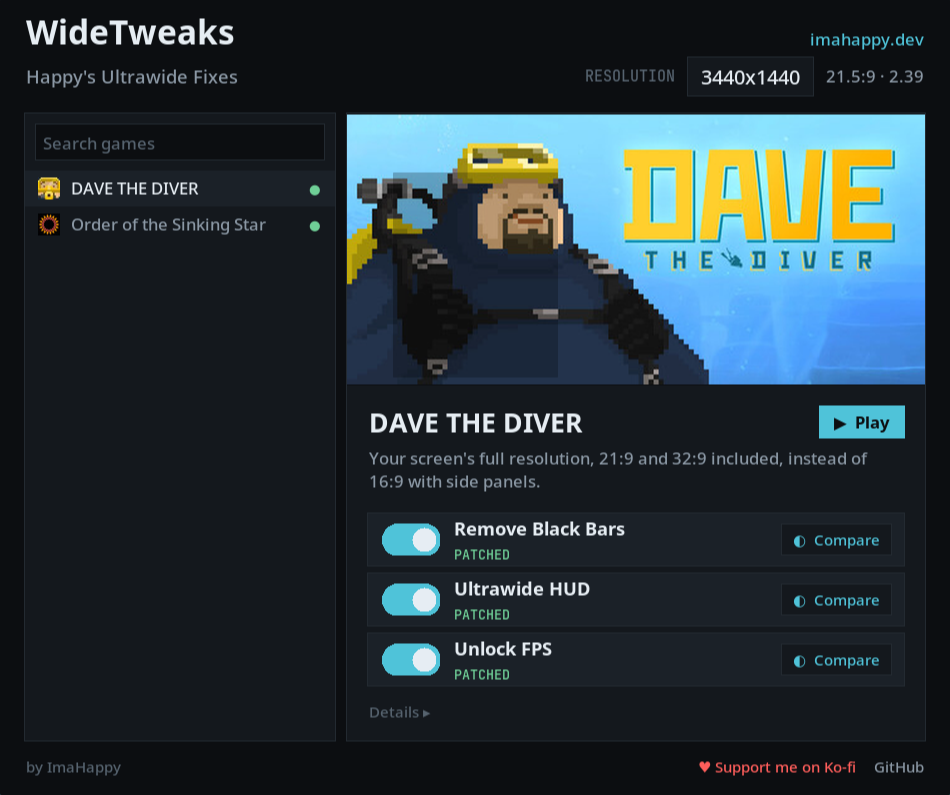
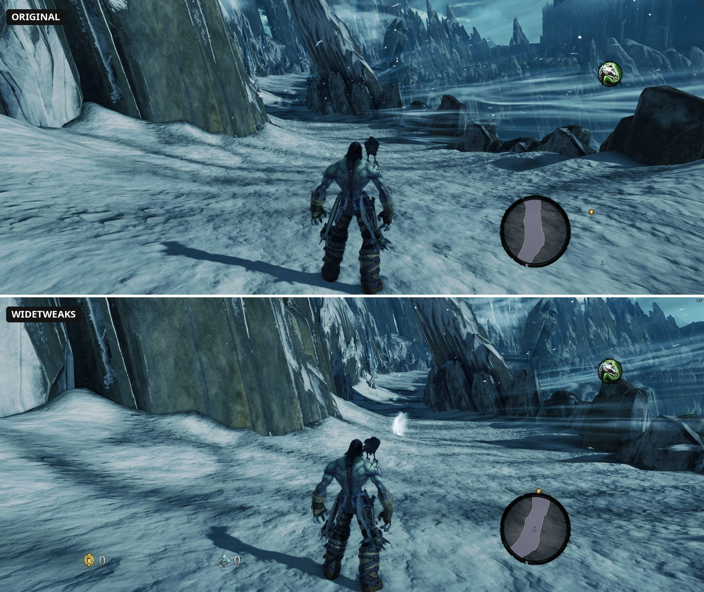
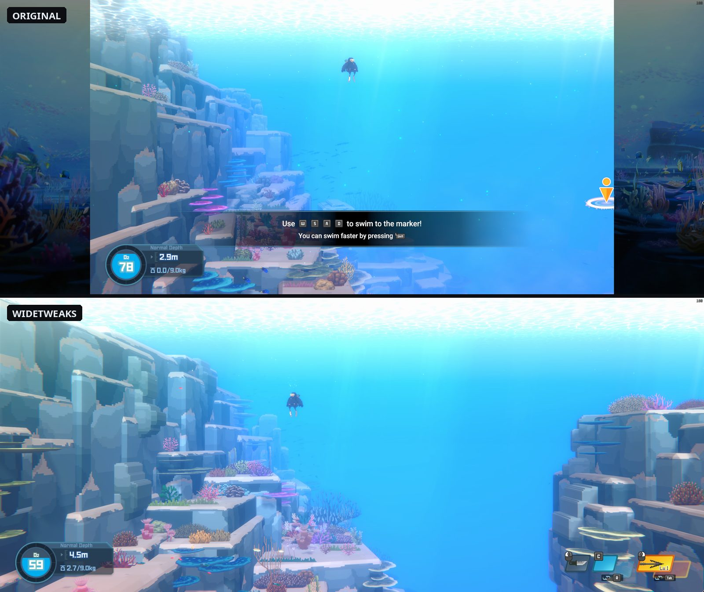
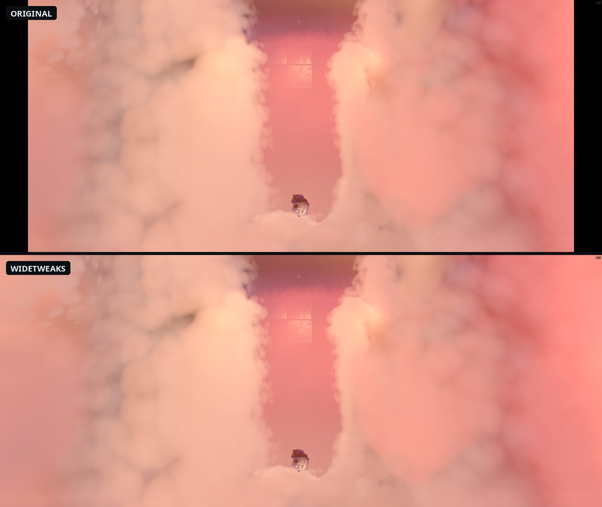
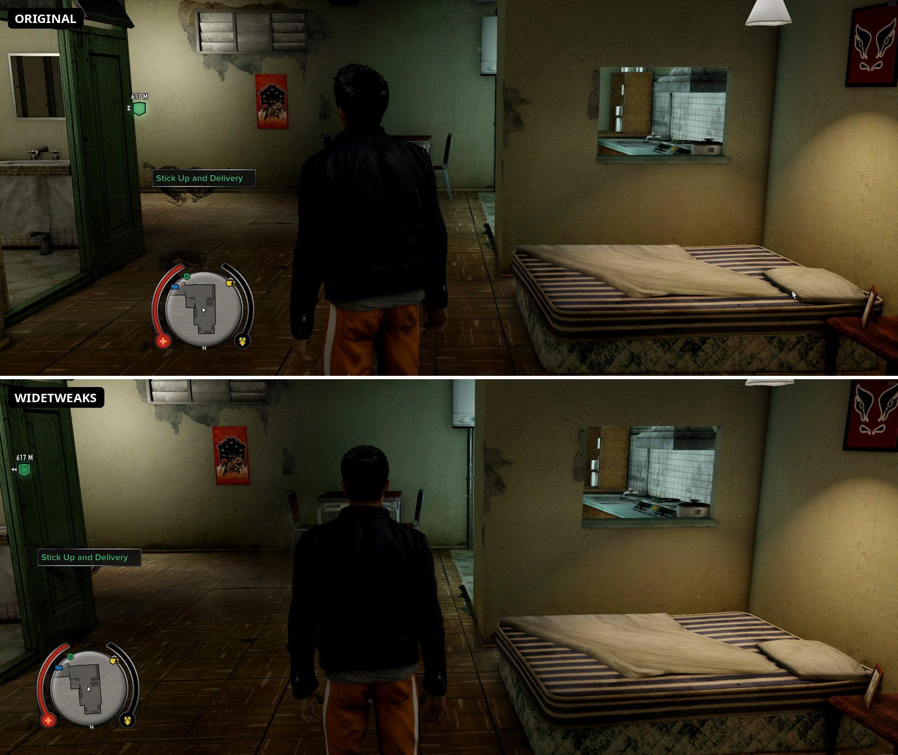

# WideTweaks

**Happy's Ultrawide Fixes** • [ImaHappy.dev](https://imahappy.dev/widetweaks)

## Supported games

| Game | Fix |
|---|---|
| [Darksiders II Deathinitive Edition](https://store.steampowered.com/app/388410/) | Minimap icons line up with the minimap (needs the DX11 beta branch "closed", code `DeathIstheRealDeal`) <a href="docs/fixes/darksiders-2.md">How it works</a>

Before / after

 |
| [DAVE THE DIVER](https://store.steampowered.com/app/1868140/) | Full width, ultrawide HUD, unlocked FPS <a href="docs/fixes/dave-the-diver.md">How it works</a>

Before / after

 |
| [Order of the Sinking Star](https://store.steampowered.com/app/499170/) | Removes the black bars on 21:9 and 32:9 <a href="docs/fixes/sinking-star.md">How it works</a>

Before / after

 |
| [Sleeping Dogs: Definitive Edition](https://store.steampowered.com/app/307690/) | Full-width cutscenes and menus, HUD at the screen edges (minimap intact) <a href="docs/fixes/sleeping-dogs.md">How it works</a>

Before / after

 |

## How to use

1. Download `WideTweaks.exe` from [Releases](../../releases).
2. Close the game and open WideTweaks.
3. Pick the game and flip its switches on. Flip them off to undo.

New games and fix updates show up in the app by themselves (it reads the fix files here on GitHub), and it tells you
when a new WideTweaks is out: one click downloads it (the .exe, or the Linux zip), checks its SHA-256 against the release and restarts; a git checkout does `git pull`.
Nothing is updated without you clicking.

Your original game file is kept as a backup, so you can always switch back (or use Steam's "Verify integrity of
game files").

**After a game update,** flip the switch on again. If the update changed too much, WideTweaks says
"unsupported game version" and leaves the game alone.

**Linux / Steam Deck:** download `WideTweaks_Linux.zip` and run `python3 widetweaks.py` (needs Python with Tk;
Pillow adds the game pictures, and `python-lz4` makes Unity games like Dave fast).

## Support

WideTweaks is free. If you want to support it: [Ko-fi](https://ko-fi.com/imahappy).

---

Want to add a game or use the command line? See [CONTRIBUTING.md](CONTRIBUTING.md).
MIT, see [LICENSE](LICENSE). Game names and trademarks belong to their owners; not affiliated with any developer or
publisher.
